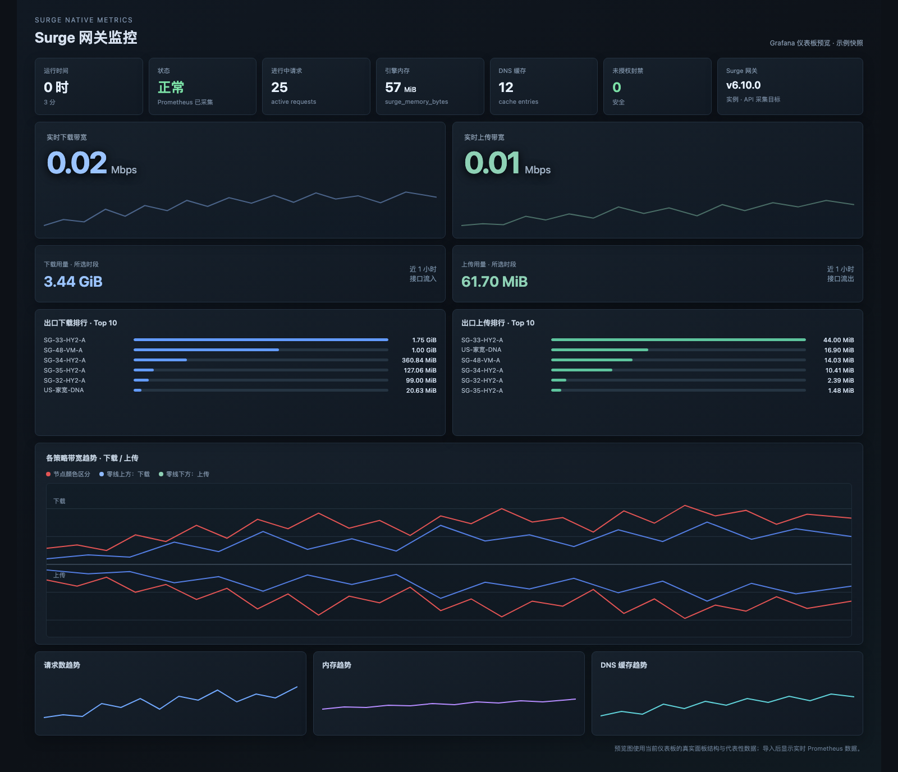

# Surge 网关监控 Grafana 仪表板

一个基于 Surge 官方 Prometheus 指标 `/v1/metrics` 的 Grafana 网关监控仪表板。



> 上图是静态预览图，用于展示布局和配色；导入 Grafana 后会显示你自己的实时 Prometheus 数据。它不是 Grafana 外部共享链接，也不会暴露任何监控数据。

## 包含内容

- 运行时间、Surge 版本、Prometheus 采集状态
- 实时下载/上传带宽：数字与曲线保持在同一面板
- 所选时段的下载/上传用量
- 出口下载/上传 Top 10 排行
- 各策略带宽趋势：零线上方为下载，零线下方为上传
- 同一节点的上传和下载使用同一种颜色
- 进行中请求、引擎内存、DNS 缓存、未授权封禁

## 使用前提

1. Surge 已开放 `/v1/metrics`，并且 Prometheus 能够正常采集。
2. Grafana 中有一个名为 `Prometheus` 的数据源；导入时也可以在 Grafana 的数据源映射步骤中选择实际的数据源。
3. Surge 指标包含 `job`、`instance`、`interface` 和 `policy` 标签。

Prometheus 示例配置：

```yaml
scrape_configs:
  - job_name: surge
    metrics_path: /v1/metrics
    # 如果 Surge HTTP API 要求密钥，只在本地配置，不要提交到 GitHub。
    # params:
    #   x-key: ["YOUR_LOCAL_SURGE_API_KEY"]
    static_configs:
      - targets: ["SURGE_HOST:API_PORT"]
```

## 导入方法

1. 下载 [`Surge-Grafana-Dashboard.json`](./Surge-Grafana-Dashboard.json)。
2. 在 Grafana 中进入 **仪表板 → 导入**，上传该 JSON 文件。
3. 如果 Grafana 要求选择数据源，选择你的 Prometheus 数据源。
4. 导入后，在顶部选择 `Surge 实例` 和 `网络接口`。

由于 Surge 通常按约一分钟的间隔采集，带宽速率使用最近 5 分钟的 `rate()` 计算，以避免采样点不足导致没有数据。

## 颜色和方向

策略趋势面板为已知策略名称绑定了颜色：同一策略的上传和下载使用同色；曲线位于零线上方或下方来表达方向。以后新增的策略会使用 Grafana 经典调色板，必要时可以在 Grafana 面板覆盖设置中补充颜色。

## 隐私和范围

本仓库只包含仪表板结构和 PromQL 查询，不包含：

- Surge API 密钥
- Prometheus 数据
- Grafana 登录信息
- 外部共享链接
- 本地局域网地址

## 文件说明

- `Surge-Grafana-Dashboard.json`：可导入 Grafana 的仪表板配置
- `Surge-Grafana-Dashboard-preview.png`：仪表板预览图
- `preview.html`：生成预览图用的静态 HTML，可直接在浏览器打开
- `LICENSE`：MIT 许可证

## 许可证

MIT License
